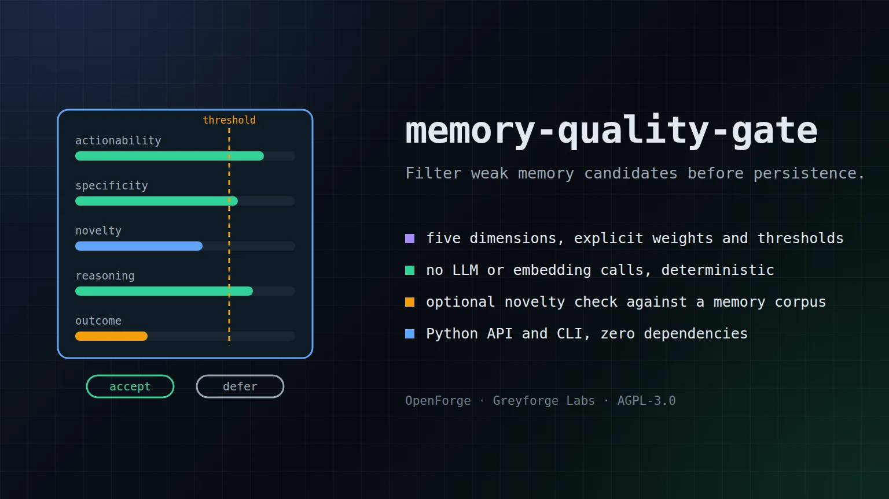

# memory-quality-gate

Zero-LLM heuristic scoring for filtering memory candidates before they reach long-term storage.

[](https://github.com/GreyforgeLabs/memory-quality-gate/actions/workflows/ci.yml)
[](https://github.com/GreyforgeLabs/memory-quality-gate/releases/latest)
[](LICENSE)

<p align="center">
  
</p>

## Why This Exists

Most agent memory systems either store too much noisy text or spend money on an LLM judge before every write. This project takes the cheap path: score each candidate with deterministic heuristics that reward actionability, specificity, novelty, reasoning, and outcome linkage. The result is a practical gate you can run inside local agents, batch pipelines, or RAG ingestion jobs with zero model calls.

## Quick Start

Install the release wheel with [pipx](https://pipx.pypa.io/) (Python 3.11 or newer):

```bash
pipx install https://github.com/GreyforgeLabs/memory-quality-gate/releases/download/v0.2.2/memory_quality_gate-0.2.2-py3-none-any.whl
memory-quality-gate check --text "Always run ./scripts/deploy.sh --dry-run before shipping v2.4.1 because it prevents partial deploys."
```

`pip install` takes the same URL inside a virtual environment, and
`pipx install 'git+https://github.com/GreyforgeLabs/memory-quality-gate@v0.2.2'` builds the same release from the tag.

To work on the code, clone it and run `./scripts/setup.sh`, which creates `.venv` with the development tools.

## Features

- Five-dimension scoring model with explicit weights and scope-aware thresholds
- No runtime dependencies and no LLM or embedding calls
- Optional novelty check against an existing memory corpus
- Python API for direct integration into memory pipelines (Python 3.11+)
- CLI for shell scripts, CI jobs, and local filtering

## Usage

```bash
memory-quality-gate score \
  --text "Always check release notes before bumping worker versions because retry semantics changed in v2.4.1." \
  --scope project
```

Example output:

```text
PASS score=0.568 threshold=0.550 scope=project
  actionability    0.70
  specificity      0.35
  novelty          0.80
  reasoning        0.60
  outcome_linkage  0.20
```

Novelty-aware scoring against an existing corpus:

```bash
memory-quality-gate check \
  --file candidate.txt \
  --existing-file existing_memory.md \
  --scope session \
  --format json \
  --redact-text
```

The CLI rejects inputs above the default caps of 1,000,000 UTF-8 bytes for
candidate text and 5,000,000 UTF-8 bytes for `--existing-file`. Local operators
can override those caps with `--max-input-bytes` and `--max-existing-bytes`.
Use `--redact-text` for JSON output that may be retained in logs.

Exit codes:

| Code | Meaning |
|---:|---|
| `0` | `score` printed a result (pass or fail), or `check` passed |
| `1` | No candidate text: no `--text`, no `--file`, and no piped stdin |
| `2` | `check` rejected the candidate, **or** a usage or input error (bad option, unreadable or oversized file, invalid UTF-8) |

A rejected candidate always prints its result on stdout, while usage and input
errors print only to stderr. Scripts that must tell the two apart can check
whether stdout is empty, or parse the `--format json` result.

`QualityGate` builds its novelty indexes on the second novelty lookup, so a long-lived
gate scoring many candidates against one corpus (`evaluate_many` or repeated
`evaluate` calls) is several times faster per candidate than one-shot use, with
identical scores. `python scripts/bench.py` reports import time, CLI wall time and
throughput on a generated corpus.

Python API:

```python
from memory_quality_gate import MemoryCandidate, QualityGate

gate = QualityGate(existing_content="Previously stored memory goes here.")
result = gate.evaluate(
    MemoryCandidate(
        text="Always rotate snapshot files after schema changes because stale fixtures mask migration bugs.",
        scope="project",
        entry_type="lesson",
    )
)

print(result.passed, round(result.weighted_score, 3), result.scores)
```

## Documentation

- [STARTHERE.md](STARTHERE.md) - AI coding client bootstrap
- [docs/scoring-model.md](docs/scoring-model.md) - Weights, thresholds, and novelty logic
- [CONTRIBUTING.md](CONTRIBUTING.md) - How to contribute
- [CHANGELOG.md](CHANGELOG.md) - Version history

## Development

```bash
. .venv/bin/activate
python -m ruff check .
python -m pytest
python -m build
python -m twine check dist/*
```

[CONTRIBUTING.md](CONTRIBUTING.md) covers the pull request and release process.

## License

AGPL-3.0. See [LICENSE](LICENSE) for details.

---

<p align="center">
  <b>Useful?</b> <a href="https://github.com/GreyforgeLabs/memory-quality-gate">Star memory-quality-gate on GitHub</a> · <a href="https://x.com/GreyforgeLabs">Follow @GreyforgeLabs</a> · <a href="https://greyforge.tech/open-source">More OpenForge tools at greyforge.tech</a>
</p>

<p align="center"><sub>Background: the <a href="https://greyforge.tech/chronicles/memory-quality-without-an-llm-judge">memory-quality-gate Chronicle</a> · <a href="https://greyforge.tech/llms.txt">Greyforge llms.txt</a></sub></p>
